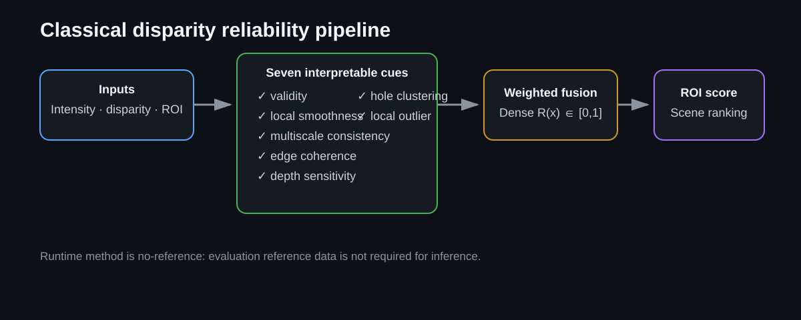
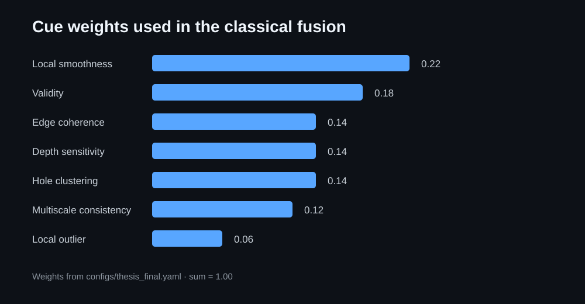
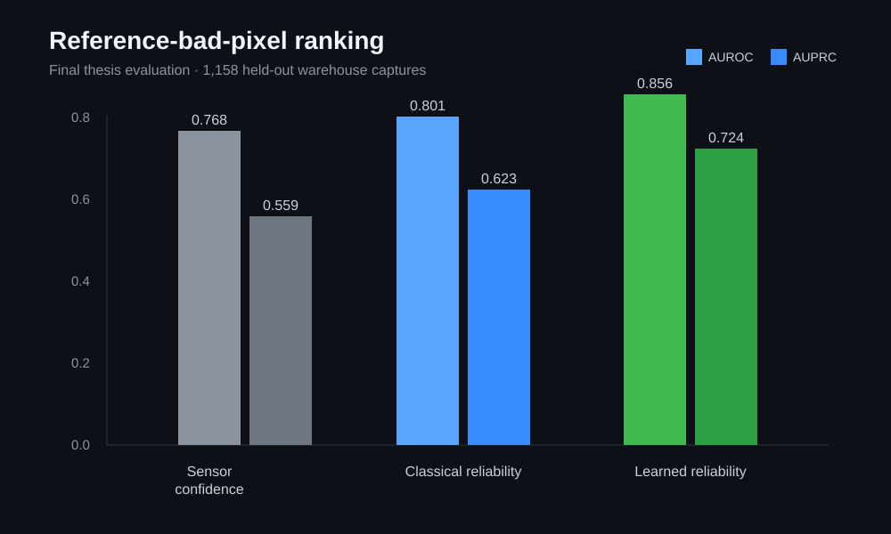
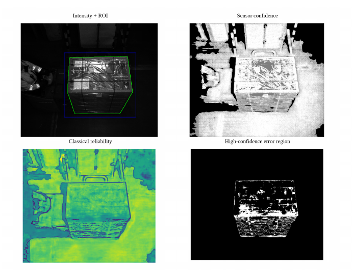
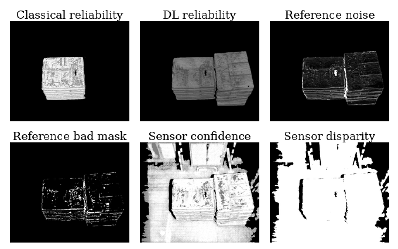

# Classical Disparity Reliability

Interpretable, no-reference disparity-quality assessment for warehouse stereo vision.

This repository implements the classical method from my Master's thesis, **Depth Data Quality and Reliability Assessment for Warehouse Environments**. The goal is to estimate whether a disparity map is structurally trustworthy **before** it is used for point-cloud reconstruction, dimension estimation, or volume estimation.

<p align="center">
  
</p>

## Why this exists

Stereo cameras can return a high confidence value even when the disparity contains holes, unsupported boundaries, local surface irregularities, or outliers. A confidence map therefore does not necessarily answer the question that matters downstream:

> Is this disparity map reliable enough to send into 3D processing?

The method in this repository addresses that question without requiring ground-truth disparity at runtime.

## Method

The pipeline takes:

- a rectified grayscale/intensity image,
- a disparity map in pixel-disparity units,
- a binary object ROI mask from an upstream segmentation stage.

It computes seven interpretable reliability cues:

| Cue | Weight | What it captures |
|---|---:|---|
| Validity | 0.18 | Missing or invalid disparity |
| Local smoothness | 0.22 | Local surface irregularity |
| Multiscale consistency | 0.12 | Structure that changes across spatial scales |
| Edge coherence | 0.14 | Agreement between image and disparity boundaries |
| Depth sensitivity | 0.14 | Regions where small disparity errors imply larger depth changes |
| Hole clustering | 0.14 | Connected missing-data structure |
| Local outlier | 0.06 | Disparity values inconsistent with their neighborhood |

The cue maps are fused into a dense reliability map \(R(x)\in[0,1]\). The ROI score then combines mean dense reliability, valid-pixel ratio, hole structure, smoothness, and disparity stability.

The exact public configuration is in [`configs/thesis_final.yaml`](configs/thesis_final.yaml).

<p align="center">
  
</p>

## Thesis evaluation

The final thesis evaluation used **1,158 held-out warehouse captures** with reference disparity for evaluation only. Higher reliability should correspond to lower reference-defined error.

<p align="center">
  
</p>

For reference-bad-pixel ranking:

| Quality signal | AUROC | AUPRC |
|---|---:|---:|
| Sensor confidence | 0.768 | 0.559 |
| **Classical reliability** | **0.801** | **0.623** |
| Learned reliability | 0.856 | 0.724 |

At **20% retained coverage**, the mean bad-pixel ratio was:

- sensor confidence: **0.170**
- classical reliability: **0.126**
- learned reliability: **0.074**

These numbers are thesis-level evaluation results. They describe ranking/filtering quality, not calibrated probabilities and not guaranteed downstream volume accuracy.

## Repository structure

```text
configs/
  thesis_final.yaml          # cue weights and parameters
src/disp_quality_classical/
  cues/                      # seven reliability cues
  fusion.py                  # weighted dense fusion
  roi_score.py               # object-level reliability score
  pipeline.py                # end-to-end classical evaluation
  cli.py                     # command-line entry point
tests/
  test_pipeline.py
```

## Run the method

The repository currently contains source code rather than a packaged Python project. From the repository root:

```bash
python3 -m venv .venv
source .venv/bin/activate
pip install numpy opencv-python pyyaml pytest
export PYTHONPATH="$PWD/src"
```

Run one disparity source:

```bash
python -m disp_quality_classical.cli \
  --config configs/thesis_final.yaml \
  --intensity /path/to/intensity_left.png \
  --sensor-disparity /path/to/disparity.png \
  --roi-mask /path/to/roi_mask.png \
  --output-dir outputs/example
```

Optionally compare sensor disparity with an already aligned deep-stereo/NFS disparity map:

```bash
python -m disp_quality_classical.cli \
  --config configs/thesis_final.yaml \
  --intensity /path/to/intensity_left.png \
  --sensor-disparity /path/to/sensor_disparity.png \
  --nfs-disparity /path/to/nfs_disp.npy \
  --roi-mask /path/to/roi_mask.png \
  --output-dir outputs/example
```

The CLI writes:

- dense reliability maps (`*.npy`),
- all seven cue maps (`*.npy`),
- ROI score and cue diagnostics (`*.json`).

## Design choices

- **No reference disparity is required at runtime.**
- Disparity arrays are not silently resized because resizing can change disparity units.
- Sensor confidence is kept as an independent baseline rather than fused into the proposed score.
- The ROI mask is assumed to come from an upstream segmentation stage.
- The method is intentionally interpretable: a low score can be traced back to specific structural cues.

## Limitations

The method uses fixed cues, weights, and thresholds. A disparity map can remain locally smooth while still containing a systematic bias that is difficult to detect without reference information. Transfer to a different sensor, camera geometry, or warehouse may therefore require renewed parameter analysis.

A high reliability score should be interpreted as **input-quality evidence**, not as proof that all later 3D processing stages will succeed. Segmentation, calibration, point-cloud generation, and measurement algorithms remain separate error sources.

## Thesis context

**M.Sc. Mechanical Engineering, specialization Mechatronics**
Universität Duisburg-Essen

Thesis: *Depth Data Quality and Reliability Assessment for Warehouse Environments*

This repository contains the classical, interpretable branch of the thesis work.
## Qualitative examples

The quantitative metrics above summarize ranking across the evaluation set. The following thesis examples show what the classical score is responding to spatially.

<p align="center">
  
</p>

The first example compares the object ROI, sensor confidence, the classical reliability map, and a high-confidence error region. Sensor confidence can remain high across structurally weak regions, while the proposed no-reference reliability map becomes more cautious around local instability and missing/irregular structure.

<p align="center">
  
</p>

The second example places classical reliability next to learned reliability, sensor confidence, sensor disparity, and reference-defined diagnostic masks for one held-out warehouse scene. The reference panels are used only for evaluation; the classical method itself remains no-reference at runtime.
